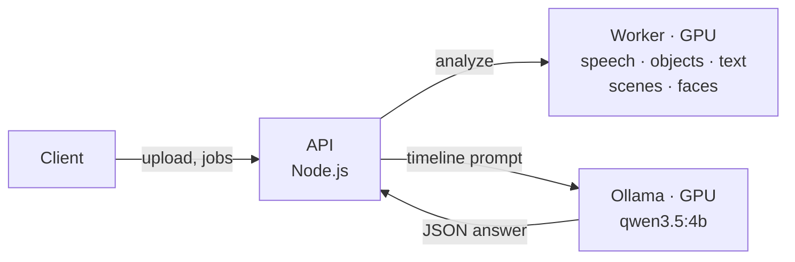

# Ollama Optivus AI


[](https://github.com/TarikSeyceri/OllamaOptivus.ai/actions/workflows/ci.yml)
[](LICENSE.md)
[](https://www.buymeacoffee.com/tarikseyceri)

**Self-hosted video understanding.** Optivus watches a video the way a person would: it transcribes the
speech, reads the on-screen text, notices objects, scene changes and facial expressions, and hands that
timeline to a local [Ollama](https://ollama.com) language model. The model answers in **the JSON structure
you ask for**: summaries, events with timestamps, call-quality scores, compliance flags. Everything runs on
your own hardware, on an NVIDIA GPU or a CPU.

## Highlights

- **Fast on one 8 GB GPU.** Models stay loaded, speech and frames are analyzed in parallel, OCR skips
  unchanged frames, and the worker and the language model hand the GPU to each other.
- **Speech:** faster-whisper `large-v3-turbo` with voice-activity detection, 99 languages, automatic
  language detection.
- **Vision:** YOLO26 objects, EasyOCR on-screen text, scene-cut detection, optional scene descriptions by a
  vision model, optional facial expressions.
- **Structured answers:** any JSON schema (Ollama structured outputs), streamed and stopped as soon as the
  JSON is complete; long videos are summarized in parts automatically.
- **Production-ready API:**
  - asynchronous jobs with long-polling;
  - content-addressed storage with deduplication;
  - an analysis cache, so re-asking the same video with another prompt is instant;
  - crash-safe job queue, retention, health checks, OpenAPI docs.
- **Secure by default:**
  - mandatory strong API keys, strict input validation, path containment;
  - non-root read-only containers, and a worker with no internet access;
  - hash-pinned dependencies (see [security](docs/security.md)).
- **Backward compatible:** the v1 endpoints (`/upload`, `/videos`, `/delete`, `/process`) still work.

## How it works



1. A video is uploaded (or referenced on a NAS) and a job is created.
2. The **worker** decodes frames by timestamp and transcribes the audio in parallel with object, text,
   scene and face analysis.
3. The **API** turns the result into a compact timeline (speech, new on-screen text, objects, scene cuts,
   captions) and asks **Ollama** for an answer that follows your JSON schema.
4. The client polls the job and gets the parsed result.

Details: [docs/architecture.md](docs/architecture.md).

## Quick start (Docker, NVIDIA GPU)

You need Docker with GPU support (NVIDIA driver 560+; on Linux the NVIDIA Container Toolkit; on Windows,
Docker Desktop with WSL 2).

```bash
git clone https://github.com/TarikSeyceri/OllamaOptivus.ai.git && cd OllamaOptivus.ai
./scripts/init.sh                 # Windows: .\scripts\init.ps1  -> creates .env and prints your API key
docker compose up -d --build      # first start builds the images and pulls the model (about 10 GB)
node scripts/smoke.mjs            # waits until ready, then analyzes a test video end to end
```

Without an NVIDIA GPU: `docker compose -f compose.yaml -f compose.cpu.yaml up -d --build`.
With Ollama already installed on the host: `docker compose -f compose.yaml -f compose.host-ollama.yaml up -d --build`.
More in [docs/deployment.md](docs/deployment.md): TLS, NAS folders, several GPUs, running without Docker.

## Usage

```bash
TOKEN=<your key>; API=http://127.0.0.1:3330

# 1. Upload
curl -s -H "Authorization: Bearer $TOKEN" -F "video=@call.mp4" $API/v1/videos
#    -> {"payload":{"video":{"id":"3f0c...e9", ...}}}

# 2. Analyze (waits up to 60 s, then keeps running in the background)
curl -s -H "Authorization: Bearer $TOKEN" -H "Content-Type: application/json" "$API/v1/jobs?wait=60" \
  -d '{"videoId":"3f0c...e9","language":"en","videoExplanation":"A support call between an agent and a customer."}'

# 3. Poll until "completed"
curl -s -H "Authorization: Bearer $TOKEN" "$API/v1/jobs/<job-id>?wait=30"
```

`node scripts/smoke.mjs` runs these steps on the bundled 14-second test clip
([test/fixtures/speech.mp4](test/fixtures/speech.mp4)). On an RTX 4060 laptop GPU the job completes in about
10 s, and `payload.job.result` is:

```json
{
  "summary": "A customer service interaction where a user named Anna contacts Optiva Support to inquire about the status of invoice 4821.",
  "events": [
    { "timestamp": 0, "description": "On-screen text displays 'OPTIVUS DEMO'." },
    { "timestamp": 1.3, "description": "Anna introduces herself as Optiva Support and asks how she can help." },
    { "timestamp": 6.5, "description": "The user requests to check the status of invoice 4821." }
  ]
}
```

This is real, unedited output of `qwen3.5:4b`. Speech recognition heard "Optivus" as "Optiva", and because
one synthetic voice speaks both parts, the model mixed up the agent and the caller.

Pass your own JSON schema in `format`, for example sentiment, satisfaction scores or checklist items
([example](docs/examples/call-center-format.json)). Choose `language` (`en`, `tr`, `de`, … or `auto`) and
`features` (`objects`, `ocr`, `scenes`, `faces`, `captions`). The full reference is in
[docs/api.md](docs/api.md); the interactive one is `/docs` (`API_DOCS_ENABLED=true`). A
[Postman collection](OllamaOptivus.ai.postman_collection.json) is included.

## Recommended models

| GPU memory | Language model (`OLLAMA_AI_MODEL`) | Speech |
|---|---|---|
| 8 GB (default) | `qwen3.5:4b`, vision-capable, fully on the GPU | `large-v3-turbo` int8 |
| 12–16 GB | `qwen3.5:9b` or `gemma4:12b` | `large-v3-turbo` fp16 |
| 24 GB | `gemma4:26b` (mixture-of-experts, fast) or `qwen3.5:27b` | `large-v3-turbo` fp16 |
| CPU / Apple Silicon | `qwen3.5:2b` | `small` int8 |

The reasoning, measured numbers and a benchmark script for your own videos are in
[docs/models.md](docs/models.md). Tuning is covered in [docs/performance.md](docs/performance.md).

## Configuration

Everything is configured with environment variables in `.env`; the init script creates the file with
random secrets. The most important settings:

| Variable | Default | |
|---|---|---|
| `HTTP_BEARER_TOKEN` | generated | API keys (comma-separated for rotation) |
| `OLLAMA_AI_MODEL` | `qwen3.5:4b` | Language model |
| `PROCESSING_FEATURES` | `objects,ocr,scenes` | Add `faces` for facial expressions |
| `OLLAMA_AI_VISION_ENABLED` | `false` | Scene descriptions by the vision model |
| `PROCESSING_FPS` | `1` | Frames analyzed per second of video |
| `FILE_RETENTION_DAYS` | `2` | When videos and results are deleted |
| `OPTIVUS_BIND` | `127.0.0.1` | Interface the API is published on |

All variables: [docs/configuration.md](docs/configuration.md).

## Security

API keys are required (the server refuses to start without strong ones). Inputs, uploads and paths are
validated strictly; the containers run unprivileged; the worker cannot reach the internet. Recordings and
transcripts never leave your machines. Read [docs/security.md](docs/security.md) before going to
production, especially the responsible-use note on facial expressions. Report vulnerabilities privately
([SECURITY.md](SECURITY.md)).

## Development

```bash
npm ci && npm test                          # API: 95 tests with fakes (no GPU needed)
cd worker && uv sync && uv run pytest       # worker: 23 tests with fake models
```

See [CONTRIBUTING.md](CONTRIBUTING.md) for the layout, the guidelines and running the stack locally.

## Documentation

| | |
|---|---|
| [Architecture](docs/architecture.md) | Components, data flow, GPU sharing, prompt construction |
| [API](docs/api.md) | Endpoints, examples, error codes |
| [Configuration](docs/configuration.md) | Every environment variable |
| [Deployment](docs/deployment.md) | Docker, TLS, NAS, several GPUs, upgrades, backups |
| [Models](docs/models.md) | Which models to use, and benchmarking |
| [Performance](docs/performance.md) | Measurements and tuning |
| [Security](docs/security.md) | Threat model, hardening, personal data |
| [Troubleshooting](docs/troubleshooting.md) | Common problems |
| [Migration from v1](docs/migration-v1-to-v2.md) | Upgrading existing installations |

## License

MIT, see [LICENSE.md](LICENSE.md). Third-party components have their own licenses; in particular, object
detection uses Ultralytics YOLO (**AGPL-3.0**) and can be switched off. See
[THIRD_PARTY_NOTICES.md](THIRD_PARTY_NOTICES.md).
