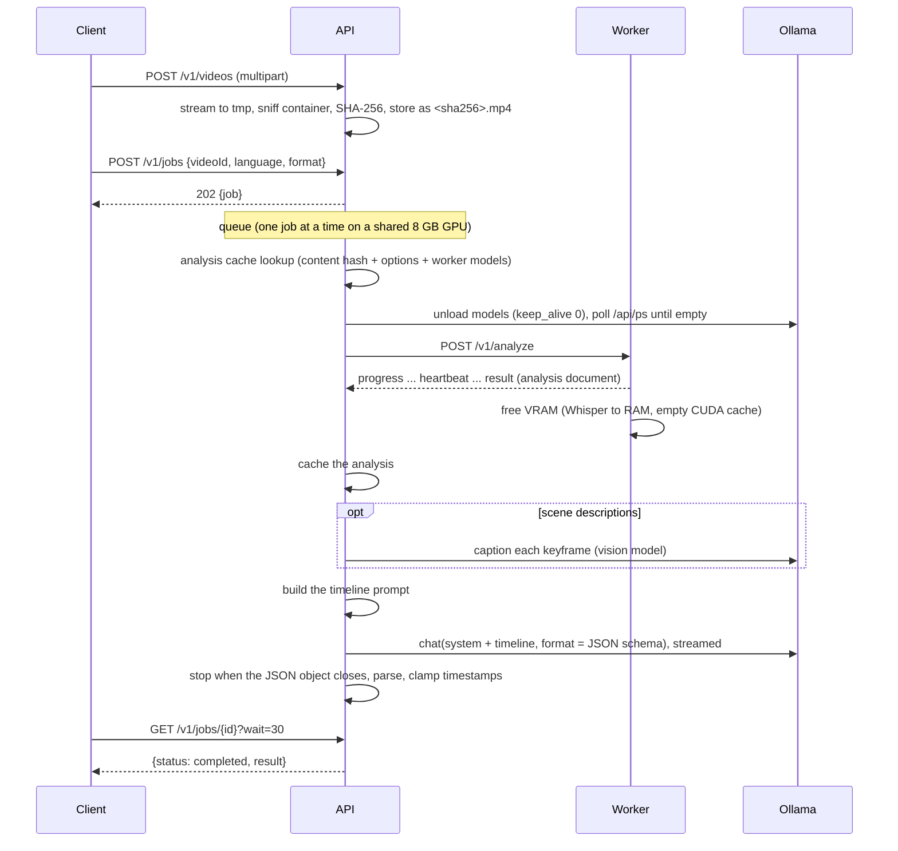

# Architecture

## Components

```mermaid
flowchart LR
  C[Client] -->|HTTPS via reverse proxy| API
  subgraph frontend network
    API["api (Node.js 26, Express 5)<br/>auth · validation · uploads · job queue<br/>prompt builder · Ollama client"]
  end
  subgraph backend network (internal, no internet)
    W["worker (Python 3.13, FastAPI)<br/>PyAV · faster-whisper · YOLO26<br/>EasyOCR · scene cuts · faces"]
    O["ollama<br/>summary + scene descriptions"]
  end
  API -->|"POST /v1/analyze<br/>NDJSON progress stream"| W
  API -->|"chat (streamed JSON)"| O
  O -.->|egress network: model pulls only| Internet
  API --- D[("data volume<br/>videos · meta · jobs · results<br/>analysis cache · keyframes · prompts")]
  W --- D
```

| Service | Responsibility | GPU | Network |
|---|---|---|---|
| **api** | Public HTTP API, authentication, rate limits, validation, uploads, content-addressed storage, persistent job queue, analysis cache, prompt building, all calls to Ollama, retention. | no | frontend + backend |
| **worker** | Video analysis: probing, frame sampling, speech-to-text, objects, on-screen text, scene cuts, facial expressions, keyframes. Stateless; models stay loaded. | yes | backend only |
| **ollama** | Runs the language model: keyframe captions and the final JSON answer. | yes | backend + egress |

Several workers can run behind one API (one per GPU): list them in `WORKER_URLS`. The API itself runs as
a single replica per data directory, which a lock file enforces.

## One job, end to end



## Sharing one 8 GB GPU

The worker (about 1.2 GB resident, up to about 3 GB at peak) and the language model (`qwen3.5:4b`, about
3.4 GB at a 16K context) both fit on one 8 GB card, but not at their peaks at the same time. With
`GPU_SHARED_LOW_VRAM=true` (the default):

1. Jobs run one at a time.
2. Before an analysis, the API unloads every Ollama model and waits until `/api/ps` is empty. The worker
   also waits for free memory.
3. After the analysis, the worker moves Whisper to system RAM and empties the CUDA cache. Reloading it
   takes about 1 s.
4. The language model loads (about 2.5 s from the page cache) and answers. The API checks that the model
   is fully on the GPU, and logs a warning if part of it was offloaded to system RAM, which is a silent
   5–10× slowdown.
5. `num_ctx` is fixed and shared by the caption and summary steps, because Ollama reloads a model whenever
   the context size changes.

With the worker and Ollama on different GPUs, set `GPU_SHARED_LOW_VRAM=false` and optionally
`JOBS_PIPELINED=true`, so the next video is analyzed while the previous summary is written.

## Video analysis (worker)

- **Decoding:** PyAV (FFmpeg) samples frames by presentation timestamp at `sampleFps`, so timing is exact
  even for variable-frame-rate phone and screen recordings. Decoding is multi-threaded, frames are
  downscaled inside FFmpeg, and the display-matrix rotation of portrait videos is applied.
- **Two parallel threads:** speech recognition and frame analysis. Inside the frame thread, a producer
  thread decodes the next batch while the GPU analyzes the current one.
- **Speech:** faster-whisper `large-v3-turbo` with voice-activity detection and batched decoding;
  segments with a high no-speech probability and low confidence (hallucinations on silence) are dropped.
  Videos without audio are fine.
- **Objects:** YOLO26 in batches (FP16 on CUDA), counted per frame (`{"person": 2}`).
- **On-screen text:** EasyOCR. To save time it runs only on scene cuts or on frames that changed visibly
  since the last read, at most every `PROCESSING_OCR_MIN_INTERVAL_SECONDS`; in between, the last result is
  reused.
- **Scene cuts:** an HSV-histogram correlation against the first frame of the current scene. Comparing
  against the scene start also catches slow fades. They drive OCR gating and keyframes.
- **Faces (opt-in):** YuNet face detection and alignment from five landmarks, then a MobileFaceNet
  expression classifier, run only on frames that contain a person.
- **Keyframes (captions):** the first frame and every scene cut (at least
  `PROCESSING_KEYFRAME_MIN_INTERVAL_SECONDS` apart), saved under `data/frames/<analysis key>/`.

### Analysis document (version 2)

```json
{
  "analysisVersion": 2,
  "video": { "duration": 14.0, "width": 640, "height": 360, "fps": 25.0, "hasAudio": true },
  "language": "en", "detectedLanguage": "en", "sampleFps": 1,
  "transcript": [{ "start": 1.26, "end": 5.1, "text": "Hello, thank you for calling ..." }],
  "frames": [
    { "t": 0.0, "objects": { "person": 1 }, "texts": ["OPTIVUS DEMO"], "sceneCut": true,
      "faces": [{ "expression": "neutral", "score": 0.83 }], "keyframe": "frames/<key>/000000000.jpg",
      "caption": "A presenter stands in front of a blue title slide." }
  ],
  "scenes": [{ "start": 0.0, "end": 7.0 }, { "start": 7.0, "end": 14.0 }],
  "timings": { "speechMs": 720, "framesMs": 1900, "totalMs": 2100 },
  "models": { "speech": "faster-whisper:large-v3-turbo/int8_float16", "objects": "ultralytics:yolo26n.pt", "ocr": "easyocr:1.7.2", "faces": null },
  "device": "cuda:0"
}
```

The legacy `/process` with `noPrompting` returns the v1 shape (`frames[{timestamp, detections, texts}]`,
`audioTranscription`), converted from this document.

## From analysis to prompt (API)

`src/core/llm/timeline.js` turns the analysis into a compact timeline:

- The whole video is covered. Speech segments and the gaps around them become windows, and long silent
  stretches are split at scene cuts and every 15 s. Each frame belongs to exactly one window.
- OCR noise is reduced:
  - fragments with fewer than three letters or digits are dropped;
  - near-duplicates are merged (`OR, ISTANBUL` vs `CR, ISTANBUL`; numbers must match exactly);
  - text visible in most of the video is reported once, as background;
  - each window lists only new text.
- Objects must appear in at least two sampled frames, which drops one-frame false positives. They are
  reported as counts, only when they change.
- Scene cuts, captions and facial-expression shares are added to the windows they belong to.

`src/core/llm/prompt.js` adds a system prompt with:

- the task;
- an injection guard (the analysis is data, not instructions);
- the timestamp convention, with the real duration;
- the JSON schema;
- the answer language.

The analysis itself goes inside `<video_analysis>` tags.

If the prompt does not fit the context window, the timeline is first compacted, then summarized in parts:
factual notes per chunk, followed by a final pass with the requested schema. The final answer is streamed,
generation stops when the JSON object closes, invalid JSON gets one retry, and timestamps outside the
video are clamped.

## Storage layout (`DATA_DIR`)

| Path | Content | Lifetime |
|---|---|---|
| `videos/` | Uploaded videos: `<sha256>.<ext>` (v1) or sanitized names (legacy) | `FILE_RETENTION_DAYS` |
| `meta/videos/` | One JSON sidecar per video file (id, original name, size, container) | with the video |
| `tmp/` | Uploads in progress (`*.part`) | cleaned at start-up |
| `json/` | Analysis cache `<sha256>.<options-hash>.json` (+ captioned variants) | `FILE_RETENTION_DAYS` |
| `frames/` | Keyframes per analysis | `FILE_RETENTION_DAYS` |
| `jobs/`, `results/` | Job records and results (written atomically) | `FILE_RETENTION_DAYS` after finishing |
| `prompts/` | Prompt per job (`STORE_PROMPTS`) | `FILE_RETENTION_DAYS` |
| `.api.lock` | Single-replica lock (refreshed every 30 s) | while running |

## Caching and idempotency

- **Videos:** content-addressed, so uploading the same bytes twice is free.
- **Analyses:** keyed by video content, worker model versions, language, sample rate and features.
  Re-asking the same video with another model, schema, explanation or temperature skips the video
  analysis entirely.
- **Captions:** cached per analysis and vision model.
- **Jobs:** an identical active job (same content and options) is reused. Recovered jobs are retried at
  most `JOB_MAX_ATTEMPTS` times.

## Security boundaries

See [security.md](security.md). In short:

- the worker and Ollama are never published, and the worker has no internet access;
- every service runs as a non-root user (Ollama excepted) with a read-only filesystem and no Linux
  capabilities;
- all input is validated with schemas;
- paths are checked lexically and after resolving symlinks, in both the API and the worker.
